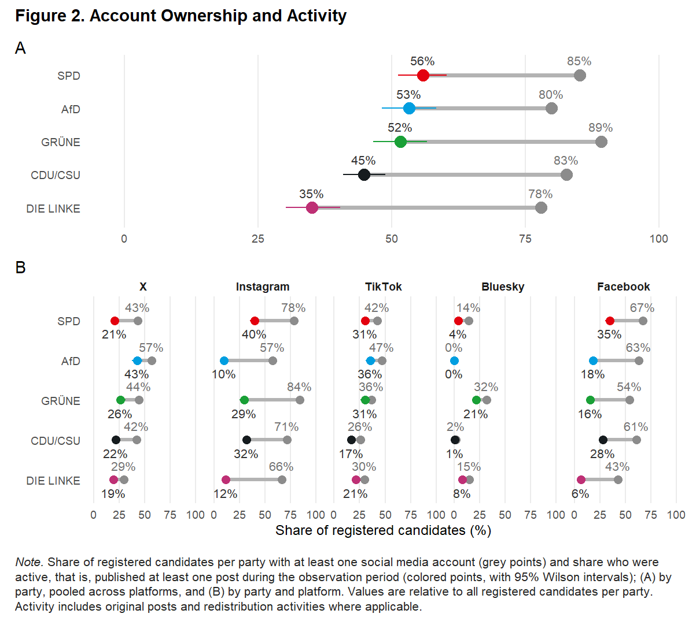
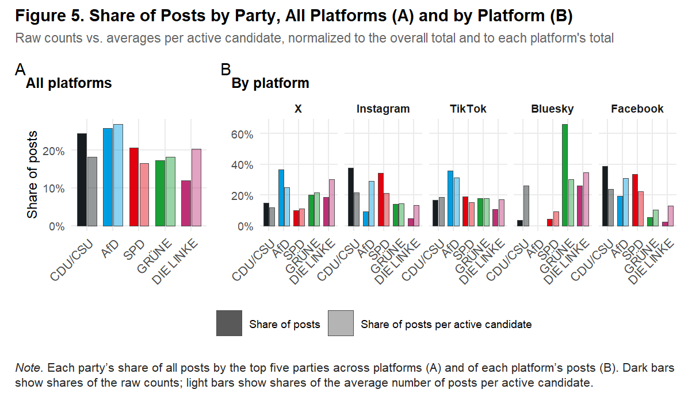
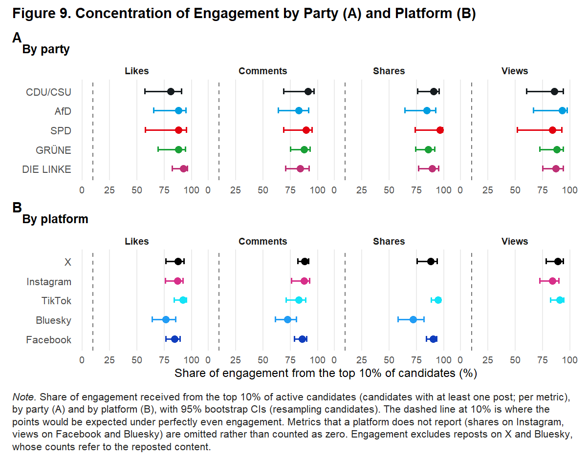

## Meet the team: DSO

- pictures and roles? 

::: notes

Previous talk by Marius und Johannes: https://www.youtube.com/watch?v=Vy5ZXW8p5g4&t=109s

- Gliederung: 1. Why, 2. How to, 3. Applications, 4. Data sharing

::: 

## Web data service

- web data service

# Studying [elections] using data from social media platforms

## Why social media platforms? 

- highly granular, large-scale data at a fraction of the cost of traditional surveys

::: notes

- Zahlen zu Social Media Nutzung

- typische Fragestellungen die Some Daten nutzen

:::

## Scientific questions

# Best practices: data access

## Conceptualization phase

1. what to collect?

- **audience-centered**: via keywords, comments, mentions, issues

- **elite-centered**: user accounts of parties or politicians, full timelines, all issues from specific set of users

2. which platforms?

3. what is the time frame? 

## Down the memory lane: API era

- API definition

$/rightarrow$ limitation: dependency on platforms

## Most promising routes right now

- apply for platform access via DSA

pros: access to non-public data, elections are scheduled

cons: takes a long time, for surprise elections reactive 

::: notes

- also link to DSA collaboratories etc. 

::: 

# Best practices: data quality

::: notes 

- nicht im Vortrag von Sebastian, aber hier könnte man kurz auf das Papier von Indira und Claudia verweisen:

https://academic.oup.com/poq/article/85/S1/399/6359490

https://journals.sagepub.com/doi/10.1177/08944393241245395
:::

# Best practices: data storage and sharing

## Storage 

small: CSV

medium: JSON or SQL database

large: server, needs resources

## Sharing

# Example #1: BTW25

## Who shows up, who speaks, who is heard?

- Parties and candidates use several platforms at once, but most studies examine one or two platforms at a time and focus on the US

- **Research question:** How did patterns of activity and audience engagement vary across politicians, parties and platforms in the 2025 German federal election?

- Starting point is the registry of **all candidates** and their accounts (Breuer et al., 2026), not a list of active accounts

  - This allows us to distinguish candidates without an account, with an account but no posts, and with active posting

::: notes

- Working paper with Ilia Frantzi, Johannes Breuer, Sina Chen, Marius Sältzer, Vigneshwaran Shankaran, Felix Beck-Soldner, Leon Fröhling, Paul Bauer and Claudia Wagner

- Three questions in the title: who has an account, who posts, who receives engagement

- The candidate registry is available from the GESIS Data Archive (ZA9076)

:::

## Data: one registry, five platforms, four access routes

| Platform  | Access route                       | Candidates who posted | Posts   |
|-----------|------------------------------------|----------------------:|--------:|
| X         | Paid API (v2)                      | 867                   | 112,388 |
| Instagram | Meta Content Library               | 667                   | 35,478  |
| Facebook  | Meta Content Library               | 557                   | 34,126  |
| TikTok    | Web scraping of public profiles    | 715                   | 14,490  |
| Bluesky   | Open developer API                 | 168                   | 9,873   |

- Observation period: December 23, 2024, to March 2, 2025 (two months before the election and one week after)

- Posts harmonized into a common schema: 213,088 posts by 1,491 candidates

- Analysis restricted to the top five parties: 144,128 posts by 1,027 candidates

::: notes

- Link back to data access: each platform requires its own route, with its own rules and costs

- Meta Content Library: data must be processed in a secure environment, only aggregate statistics can be exported

- Comparability is limited: no shares on Instagram, no views on Facebook and Bluesky, no follower counts for Facebook and Instagram

- Reposts on X and Bluesky carry the counts of the reposted content, so they are excluded from engagement measures

- Less than 25% of posts on X are original posts, so the definition of a "post" matters

:::

## Owning an account is not the same as using it

:::: {.columns}

::: {.column width="60%"}

:::

::: {.column width="40%"}
- 78% (Die Linke) to 89% (Die Grünen) of candidates own at least one account

- Only 35% (Die Linke) to 56% (SPD) posted during the campaign

- The gap is smallest for AfD (26.5 percentage points) and largest for Die Linke (42.9 percentage points)
:::

::::

::: notes

- An account costs little, sustained posting requires time, staff and strategic commitment

- We measure observable activity: part of the gap may reflect accounts our collection could not capture

:::

## Each platform has its own dominant parties

:::: {.columns}

::: {.column width="60%"}

:::

::: {.column width="40%"}
- **X and TikTok:** dominated by AfD (37% and 36% of posts)

- **Instagram and Facebook:** mainly CDU/CSU and SPD

- **Bluesky:** about two thirds of posts by Die Grünen, about a quarter by Die Linke

- Per active candidate, challenger parties (AfD, Die Linke) post 1.37 times as much as established parties
:::

::::

::: notes

- Dark bars: share of posts, light bars: share of posts per active candidate

- Challenger advantage is located mainly on X and TikTok

- Single-platform studies cannot detect this kind of platform specialization

:::

## A few candidates receive most of the attention

:::: {.columns}

::: {.column width="60%"}

:::

::: {.column width="40%"}
- The most active 10% of candidates produce 38% to 55% of their party's posts

- The top 10% receive 81% to 97% of their party's engagement

- Concentration is strongest on TikTok (more than 90% of likes, shares and views)

- Rather than one online campaign, the election unfolds as **several parallel campaigns**
:::

::::

::: notes

- Leading figures: Merz, Weidel, Scholz and Habeck. Die Linke has no common leading candidate across platforms

- Followers are concentrated too, and strongly correlated with likes

- Closer to normalization than to equalization within parties

- Takeaway for research practice: findings from one platform do not simply generalize to others

:::

# Example #2

::: notes

- use text analysis or network study as example??

:::

# New (old) challenges: multimodality

## Text is out

- numbers on video platform usage

- research example, e.g., btw on tiktok?

::: notes

multimodal: aktuelle forschung, dann pipeline und herausforderungen: speicherokatz, komplexität, legales

::: 

## Challenges

- Memory

- Complexity

- Legal questions

::: notes

- but handling multimodal data is difficult for multiple reasons...

:::

## Piloting a multimodal analysis pipeline

- pipeline viz

# New challenges: the end of "social" media?

## Algorithms, influencers, AI

- platforms are becoming more and more algorithmically curated

- How can we deal with this?

# What can we do for you

## Datasets at GESIS

## Beyond the web data service

- Consulting

- Guides

- AppKit

- Panel.dbd 

# Thank you!

Paul: [paul.bauer\@gesis.org](paul.bauer@gesis.org)

Jula: [jula.luehring\@gesis.org](jula.luehring@gesis.org)

